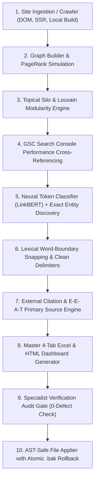

# LinkBERT Pro

[](https://opensource.org/licenses/MIT)
[](https://www.python.org/)
[](https://huggingface.co/dejanseo/LinkBERT)
[](https://github.com/muyiwaadekojede/LinkBERT-Pro)
[](https://github.com/muyiwaadekojede/LinkBERT-Pro)

**LinkBERT Pro** is an open-source, enterprise-grade SEO internal and external link optimization engine, web graph simulator, and citation intelligence framework.

It bridges computational linguistics (neural token classification, dense vector embeddings, cross-encoder re-ranking) with graph theory (Markov chain PageRank simulation, Louvain community modularity, Shannon entropy) and empirical search engine patent principles (Google Reasonable Surfer, topical silo preservation, E-E-A-T citation verification).

---

## 1. Origins, Credit & Community Attribution

### The Original Foundation: Dan Petrovic & DEJAN Marketing
This project builds directly upon the pioneering conceptual and machine learning foundations laid by Australian SEO researcher and innovator **Dan Petrovic** ([DEJAN Marketing](https://dejanmarketing.com), [GitHub: @dejanmarketing](https://github.com/dejanmarketing), [Dejan AI](https://dejan.ai)).

#### What Was the Original Work?
Dan Petrovic introduced the breakthrough concept that hyperlink placement should not be treated as simplistic keyword matching, but as a sequence labeling / token-classification problem. He trained and released the original **`dejanseo/LinkBERT`** and **`dejanseo/LinkBERT-XL`** model weights on Hugging Face:
* **Hugging Face Model Hub**: [`dejanseo/LinkBERT`](https://huggingface.co/dejanseo/LinkBERT)
* **Original GitHub Repository**: [`dejanmarketing/linkBERT`](https://github.com/dejanmarketing/linkBERT)
* **Research & Concept**: [LinkBERT by Dan Petrovic](https://dejanmarketing.com/linkbert/)

In his original open-source scripts, Dan fine-tuned BERT (`bert-large-cased`) on editorial web corpora as a binary token classifier ($P(\text{link} \mid \text{token})$), identifying human-like, contextual anchor phrases inside unstructured text blocks.

### The Evolution: LinkBERT Pro
To provide the broader search community with a production-ready, site-wide optimization architecture, **LinkBERT Pro** extends Dan Petrovic's foundational model into a complete multi-tier link intelligence platform:

```
┌────────────────────────────────────────────────────────────────────────┐
│                        LinkBERT Pro Ecosystem                          │
├────────────────────────────────┬───────────────────────────────────────┤
│ Foundational Component (Dan)   │ Enterprise Extension (LinkBERT Pro)   │
├────────────────────────────────┼───────────────────────────────────────┤
│ • Raw token-level link binary  │ • Bidirectional lexical word-boundary │
│   probability prediction       │   snapping & delimiter cleaning       │
│ • Local text string evaluation │ • Site-wide DOM crawler with SSR &    │
│ • Independent anchor guessing  │   Next.js client-side fallback rescue │
│                                │ • Full Markov chain PageRank & equity │
│                                │   flow simulation                     │
│                                │ • Louvain modularity & topical silo   │
│                                │   isolation matrices                  │
│                                │ • Google Search Console GSC organic   │
│                                │   query-to-landing-page intelligence  │
│                                │ • Empirical E-E-A-T citation engine   │
│                                │   routing to primary data repositories│
│                                │ • AST-safe HTML/MDX file patcher with │
│                                │   atomic .bak rollback guarantees     │
│                                │ • 4-tab Excel workbook generator &    │
│                                │   Specialist Verification Audit Gate  │
└────────────────────────────────┴───────────────────────────────────────┘
```

---

## 2. Scientific & Theoretical Foundations

LinkBERT Pro is grounded in published peer-reviewed computer science literature, graph mathematics, and patented search engine ranking algorithms:

```
                                  ┌───────────────────────────────┐
                                  │      LinkBERT Pro Engine      │
                                  └───────────────┬───────────────┘
                                                  │
         ┌────────────────────────┬───────────────┴───────────────┬────────────────────────┐
         │                        │                               │                        │
         ▼                        ▼                               ▼                        ▼
┌──────────────────┐    ┌──────────────────┐            ┌──────────────────┐     ┌──────────────────┐
│  Link-Aware NLP  │    │  Random Surfer   │            │ Louvain Siloing  │     │ Shannon Entropy  │
│  Yasunaga (2022) │    │ PageRank & Patent│            │  Blondel (2008)  │     │  Shannon (1948)  │
│  Petrovic (2022) │    │  Dean et al 2010 │            │ Modularity Q Max │     │ Diversity Guard  │
└──────────────────┘    └──────────────────┘            └──────────────────┘     └──────────────────┘
```

### 1. Pretraining Language Models with Document Links
* **Reference**: Yasunaga, M., Leskovec, J., & Liang, P. (2022). *LinkBERT: Pretraining Language Models with Document Links*. **ACL 2022**, pp. 8003–8016. [arXiv:2203.15827](https://arxiv.org/abs/2203.15827).
* **Application**: Treats hyperlinks as first-class semantic relationships between document pairs, capturing multi-hop contextual relevance across web documents.

### 2. Markov Chain PageRank & Link Equity Allocation
* **Reference**: Page, L., Brin, S., Motwani, R., & Winograd, T. (1999). *The PageRank Citation Ranking: Bringing Order to the Web*. Technical Report 1999-66, Stanford InfoLab.
* **Mathematical Formulation**:
  $$PR(u) = \frac{1 - d}{N} + d \sum_{v \in B_u} \frac{PR(v)}{L(v)}$$
  where $d = 0.85$ (damping factor), $N$ is total site pages, $B_u$ is the set of pages linking to $u$, and $L(v)$ is the outbound link count of $v$. LinkBERT Pro executes power iteration to quantify projected equity boost before links are committed.

### 3. The Reasonable Surfer Model
* **Reference**: Dean, J., Ghemawat, S., et al. (2010). *Ranking Documents Based on User Behavior and Link Analysis*. **US Patent 7,716,225 B1**, assigned to Google LLC.
* **Application**: Link weighting is non-uniform; editorial links in primary body content receive higher probabilistic traversal weight than footer/navigation links. Headings (`<h1>`-`<h6>`) and code blocks are strictly excluded.

### 4. Graph Modularity & Topical Silo Cohesion
* **Reference**: Blondel, V. D., Guillaume, J.-L., Lambiotte, R., & Lefebvre, E. (2008). *Fast unfolding of communities in large networks*. **Journal of Statistical Mechanics: Theory and Experiment**, 2008(10), P10008.
* **Mathematical Formulation**:
  $$Q = \frac{1}{2m} \sum_{i,j} \left[ A_{ij} - \frac{k_i k_j}{2m} \right] \delta(c_i, c_j)$$
* **Application**: Enforces topical cluster isolation. Recommends internal links within the same thematic silo and penalizes cross-silo hallucinations (e.g. Core Web Vitals linking to Web 2.0 link building) with a $-100.0$ penalty.

### 5. Anchor Text Diversity via Shannon Entropy
* **Reference**: Shannon, C. E. (1948). *A Mathematical Theory of Communication*. **Bell System Technical Journal**, 27(3), 379–423.
* **Mathematical Formulation**:
  $$H(X) = - \sum_{i=1}^n P(x_i) \log_2 P(x_i)$$
* **Application**: Evaluates the distributional entropy of inbound anchor text profiles for every target page. Flags targets where $H(X) < 1.5$ bits or exact-match ratios exceed 60% to safeguard against Google Penguin algorithmic penalties.

### 6. E-E-A-T & Empirical Citation Verification
* **Reference**: Google LLC. (2022–2024). *Search Quality Rater Guidelines: Experience, Expertise, Authoritativeness, and Trustworthiness (E-E-A-T)*.
* **Application**: Replaces subjective claims and unlinked empirical statements with verified citations to primary repositories (W3Techs, HTTP Archive, StatCounter, RFC Editor, Pew Research, GitHub). Enforces strict site-wide outbound domain budgets (max 2 outbound links per external domain).

---

## 3. Core Architecture & Pipeline



---

## 4. Installation

```bash
# Clone the repository
git clone https://github.com/muyiwaadekojede/LinkBERT-Pro.git
cd LinkBERT-Pro

# Create a virtual environment
python -m venv .venv
source .venv/bin/activate  # On Windows: .venv\Scripts\activate

# Install dependencies and CLI
pip install -e .
```

Verify your installation:
```bash
linkbert doctor
```

---

## 5. CLI Usage & Workflows

### 1. Scan and Index a Website
Scan a live website via XML sitemaps or rendered DOM:
```bash
linkbert scan https://example.com --max-pages 500 --out .my_index
```
Or index a local static build directory (`dist/`, `out/`, `build/`):
```bash
linkbert scan ./dist --out .my_index
```

### 2. Graph Topology & PageRank Audit
Compute internal link equity, in-degree/out-degree distribution, and detect orphan pages:
```bash
linkbert graph --index .my_index
```

### 3. Generate Link Recommendations with GSC Intelligence
Generate high-confidence internal and external links using GSC search performance data:
```bash
linkbert suggest --index .my_index --gsc search_console_performance.csv --min-score 0.40
```
This generates:
* `link_architecture_master.xlsx` (4-tab Master Workbook)
* `suggestions.csv` (Detailed internal link placement candidates)
* `external_links.csv` (E-E-A-T primary authority citations)
* `report.html` (Interactive visual network dashboard)
* `graph_metrics.json` (PageRank & topology metrics)

### 4. Run the Specialist Verification Audit Gate
Run the automated 4-specialist verification gate to guarantee 0 anchor truncations, 0 placeholder URLs, and 100% topical silo consistency:
```bash
python tests/verify_deliverable.py .my_index/link_architecture_master.xlsx
```

### 5. AST-Safe File Placement & Rollback
Safely apply approved links directly to HTML, Markdown, or MDX files:
```bash
# Preview changes safely with a diff
linkbert apply --index .my_index --dry-run --diff

# Apply links with automatic atomic .bak backups
linkbert apply --index .my_index --min-score 0.45

# Instant rollback if needed
linkbert rollback --index .my_index

# Commit changes (removes backup files)
linkbert commit --index .my_index
```

---

## 6. The 4-Tab Master Workbook

LinkBERT Pro exports a complete strategic link architecture workbook (`link_architecture_master.xlsx`):

| Tab | Name | Contents |
|---|---|---|
| **Tab 1** | `Internal_Linking_Blueprint` | Source URL, Target URL, Clean Anchor Text, Exact Sentence Context, Confidence Score, Anchor Type, Projected Target PageRank Boost. |
| **Tab 2** | `External_Authority_Citations` | Source URL, Exact Sentence Context, Anchor Text, Primary Authority URL (W3Techs, HTTP Archive, RFCs), Authority Domain, Source Category. |
| **Tab 3** | `GSC_Cannibalization_Intelligence` | Search Query, Primary Target URL, Secondary Competing URLs, Split Clicks & Impressions, Canonical Consolidation Anchor. |
| **Tab 4** | `Graph_Topology_Audit` | Page URL, Inbound Internal Links, Outbound Internal Links, PageRank Score, Status (`ORPHAN`, `UNDER_LINKED`, `HEALTHY`), Hub Recommendations. |

---

## 7. Automated Specialist Verification Gate

Every deliverable generated by LinkBERT Pro is checked by an automated 4-specialist audit committee ([`tests/verify_deliverable.py`](file:///tests/verify_deliverable.py)):

1. **Specialist 1 (Internal SEO & Anchor Text Naturalness)**:
   * Rejects anchors with trailing prepositions or unclosed parentheses (e.g. `"in the"`, `"compared with ("`).
   * Rejects leading conversational CTAs (e.g. `"Read more at"`, `"Discover our"`).
   * Rejects anchors under 3 characters or over 60 characters.
2. **Specialist 2 (External Citations & E-E-A-T Compliance)**:
   * Rejects placeholder URLs (`#citation-needed`, `http://TODO`).
   * Enforces outbound link domain budget (maximum 2 links per domain site-wide).
   * Enforces primary empirical citation sources for statistical assertions.
3. **Specialist 3 (Topical Silo & Information Architecture)**:
   * Enforces cluster modularity (Core Web Vitals cannot link to link building).
   * Rejects cross-silo semantic hallucinations.
4. **Specialist 4 (GSC Query Optimization & Cannibalization)**:
   * Validates query volume mapping and canonical equity consolidation.

---

## 8. Academic Citations

If you use LinkBERT Pro or the underlying LinkBERT model in your research, academic work, or production software, please cite both the foundational work and the Pro framework:

```bibtex
@software{adekojede2026linkbertpro,
  author       = {Adekojede, Muyiwa and Petrovic, Dan},
  title        = {LinkBERT Pro: Enterprise-Grade SEO Internal and External Link Architecture, Graph Simulation, and Citation Intelligence Engine},
  year         = {2026},
  publisher    = {GitHub},
  journal      = {GitHub repository},
  howpublished = {\url{https://github.com/muyiwaadekojede/LinkBERT-Pro}}
}

@misc{petrovic2022linkbert,
  author       = {Petrovic, Dan},
  title        = {LinkBERT: Natural Hyperlink Anchor Prediction with Fine-Tuned Language Models},
  year         = {2022},
  publisher    = {Hugging Face},
  howpublished = {\url{https://huggingface.co/dejanseo/LinkBERT}}
}

@inproceedings{yasunaga2022linkbert,
  title        = {LinkBERT: Pretraining Language Models with Document Links},
  author       = {Yasunaga, Michihiro and Leskovec, Jure and Liang, Percy},
  booktitle    = {Proceedings of the 60th Annual Meeting of the Association for Computational Linguistics (Volume 1: Long Papers)},
  pages        = {8003--8016},
  year         = {2022},
  url          = {https://arxiv.org/abs/2203.15827}
}

@techreport{page1999pagerank,
  title        = {The PageRank Citation Ranking: Bringing Order to the Web},
  author       = {Page, Lawrence and Brin, Sergey and Motwani, Rajeev and Winograd, Terry},
  institution  = {Stanford InfoLab},
  year         = {1999},
  number       = {1999-66}
}

@patent{dean2010reasonable,
  title        = {Ranking Documents Based on User Behavior and Link Analysis},
  author       = {Dean, Jeffrey and Ghemawat, Sanjay and others},
  number       = {US 7,716,225 B1},
  year         = {2010},
  assignee     = {Google LLC}
}

@article{blondel2008louvain,
  title        = {Fast unfolding of communities in large networks},
  author       = {Blondel, Vincent D and Guillaume, Jean-Loup and Lambiotte, Renaud and Lefebvre, Etienne},
  journal      = {Journal of Statistical Mechanics: Theory and Experiment},
  volume       = {2008},
  number       = {10},
  pages        = {P10008},
  year         = {2008}
}

@article{shannon1948entropy,
  title        = {A Mathematical Theory of Communication},
  author       = {Shannon, Claude E},
  journal      = {Bell System Technical Journal},
  volume       = {27},
  number       = {3},
  pages        = {379--423},
  year         = {1948}
}
```

---

## 9. Community & Contributing

LinkBERT Pro is open-sourced under the [MIT License](LICENSE) for the benefit of the global search engineering, data science, and technical SEO community. 

Contributions, bug reports, and feature proposals are welcome! Please open an issue or submit a pull request on [GitHub](https://github.com/muyiwaadekojede/LinkBERT-Pro).

---

## 10. License

Distributed under the **MIT License**. See [`LICENSE`](LICENSE) for full details.

*Copyright (c) 2026 Muyiwa Adekojede. Original LinkBERT Model & Concept Copyright (c) Dan Petrovic (DEJAN Marketing).*
